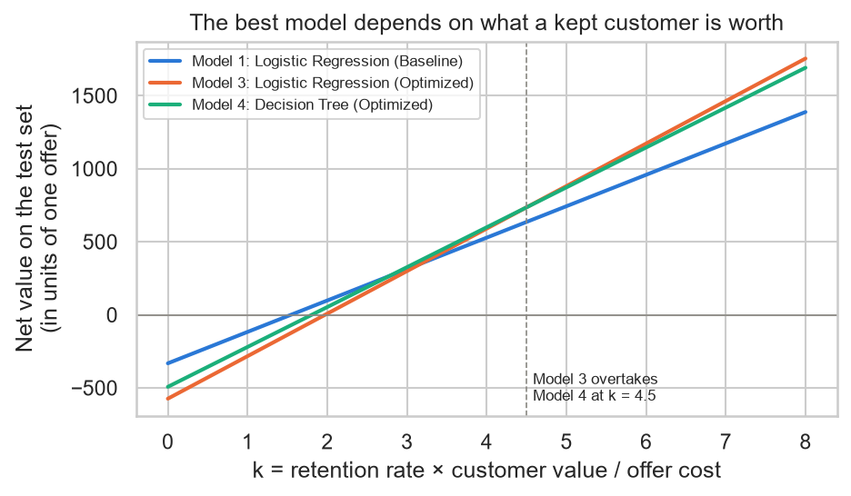
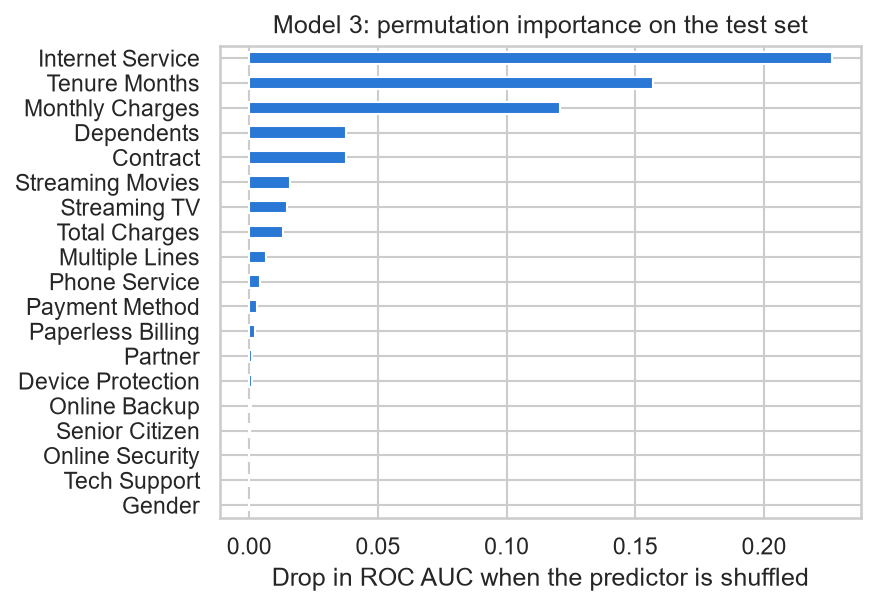

# Telco Customer Churn Prediction

[](https://github.com/jonahernan99/telco-churn-prediction/actions/workflows/ci.yml)

Predicting which customers of a telecom provider will leave, with Logistic Regression and Decision Trees, and
deciding which model to use **from the business costs instead of from F1 alone**.

The full analysis is in [`notebooks/churn_prediction.ipynb`](notebooks/churn_prediction.ipynb), executed end to end
with every output saved.

## Highlights

- **Leakage found and removed.** IBM's own `Churn Score` correlates 0.66 with churn (every churner scores at least
  65), and `CLTV` and `Churn Reason` are model outputs or known only after the customer left. All three are dropped.
- **Leak-free preprocessing.** Scaling and one-hot encoding live inside a scikit-learn `Pipeline`, so cross-validation
  and the test set never influence the fitted transformers. The test set is used once, after both grid searches.
- **Imbalance handled deliberately.** 26.5% of customers churn. Models are tuned on the F1 score of the churn
  class, and `class_weight="balanced"` turned out to be the main lever for Logistic Regression (recall 0.581 → 0.810
  in cross-validation).
- **A cost-sensitivity analysis decides between the models**, with the break-even point at which each model becomes
  worth more.
- **The recommended model is explained directly** with coefficients, permutation importance and a surrogate tree
  whose agreement with the model is measured (92.1%).
- **Every number in the text is checked against the outputs** by [`scripts/check_numbers.py`](scripts/check_numbers.py),
  which runs in CI.

## Results

Test set: 1,409 customers (374 churners), stratified 80/20 split, `random_state=42`. Precision, recall and F1 refer
to the churn class.

| Model | Train acc. | Test acc. | Precision | Recall | F1 | ROC AUC |
|---|---:|---:|---:|---:|---:|---:|
| 1. Logistic Regression (baseline) | 0.813 | **0.804** | **0.648** | 0.575 | 0.609 | **0.849** |
| 2. Decision Tree (baseline) | 0.998 | 0.744 | 0.517 | 0.527 | 0.522 | 0.674 |
| 3. Logistic Regression (optimized: C = 100, balanced) | 0.762 | 0.740 | 0.507 | **0.778** | 0.614 | 0.848 |
| 4. Decision Tree (optimized: depth 4, entropy, balanced) | 0.782 | 0.772 | 0.554 | 0.730 | **0.630** | 0.841 |

- The unconstrained tree memorizes the training set (depth 30, 1,051 leaves). Limiting it to depth 4 cuts the
  train-test gap from 0.254 to 0.010 and raises test F1 from 0.522 to 0.630.
- Models 3 and 4 are close. Model 4 has the higher test F1, and Model 3 the higher cross-validated F1 (0.641 vs 0.630)
  and recall.

## Which model should the company use?

Say every flagged customer gets a retention offer costing *c*, a contacted churner is kept with probability *r*, and a
kept customer is worth *V*. The campaign's value then depends on one number, **k = r·V / c**: how many offers one
reached churner is worth.



| k | Best model |
|---|---|
| below 1.54 | none: no campaign pays off |
| 1.54 – 2.78 | Model 1 (fewest wasted offers) |
| 2.78 – 4.50 | Model 4 |
| above 4.50 | Model 3 |

With its default cut-off, Model 3 reaches 18 more churners than Model 4 but sends 81 more offers. That only pays off
if a kept churner is worth more than 4.5 offers, which the data cannot tell us. But Model 3 gives 1,407 distinct risk
scores, against the tree's 13. Restricted to its top 493 customers (Model 4's contact count), it reaches 272 churners,
compared with Model 4's 273. **Recommendation: pilot Model 3 and set its cut-off from the k the pilot measures.**

## What drives Model 3's predictions?



Internet service type, tenure and monthly charges matter most. Fiber optic raises the odds of churn (odds ratio
6.1); dependents, two-year contracts and longer tenure lower them. A depth-3 surrogate tree reproduces Model 3's
decisions for 92.1% of test customers with one rule: *month-to-month contract, no dependents, has internet service*.

## Review feedback addressed

This project started as a group assignment. The instructor's review raised three points, and this version fixes
each one:

| Feedback | Change |
|---|---|
| The optimized Logistic Regression results in the report did not match the notebook outputs. | The notebook is re-executed end to end with pinned library versions, and every number in the text was checked against the new outputs. `scripts/check_numbers.py` fails CI if a decimal number in the text appears in no output. |
| The recommendation assumed retention offers are inexpensive, with no cost analysis. | New Section 5.4: break-even values of k for every pair of models, an illustrative estimate of k, and a check that Model 3's cut-off can be moved to Model 4's operating point. The recommendation is now conditional on k. |
| The Decision Tree rules explain that model, not the recommended Logistic Regression. | New Section 5.6 explains Model 3 itself (odds ratios, permutation importance, surrogate tree with measured fidelity). The tree rules in Section 5.7 are presented only as patterns in the data. |

## Reproduce

```bash
python -m venv .venv
source .venv/bin/activate        # Windows: .venv\Scripts\activate
pip install -r requirements.txt
```

1. Download the dataset as described in [`data/README.md`](data/README.md).
2. Run the notebook: `jupyter nbconvert --to notebook --execute --inplace notebooks/churn_prediction.ipynb`
   (or open it in Jupyter or VS Code). It takes about a minute.
3. Check the text against the outputs: `python scripts/check_numbers.py`

The checker catches any decimal number in the text that no output contains. It cannot tell *which* table a number
came from, so a wrong value that happens to appear elsewhere passes. It is a safety net, not a proof.

## Project structure

```
notebooks/churn_prediction.ipynb   analysis: EDA, preprocessing, four models, evaluation, cost analysis, explanations
scripts/check_numbers.py           checks that the numbers in the text match the outputs
tests/                             tests for the checker
figures/                           figures used in this README, exported from the notebook
data/                              place the dataset here (not committed)
```

## Limitations

- IBM presents the data as a sample from a fictional company. It is one snapshot without dates, so it cannot show
  that every predictor was measured before the customer left.
- A single train/test split. The break-even values rest on differences of a few dozen customers.
- The cost analysis assumes the same retention rate for every contacted churner and no real costs are available.
- `Dependents` is an influential personal attribute; its use should be reviewed for fairness before deployment.

## Credits

The original analysis was a group assignment for MCAI500 (Machine Learning) in the Master of Computer Science in
Applied Artificial Intelligence at the University of Niagara Falls Canada, by:

- Juan Davila
- Alan Andre Guijarro Pomboza
- Jonathan Hernandez Bautista
- Jaime Williams Potes Pardo

This revised version, with the cost-sensitivity analysis, the explanation of the recommended model and the number
checks, is maintained by Jonathan Hernandez.

Dataset: IBM, *Telco Customer Churn* (IBM sample data), as distributed on
[Kaggle](https://www.kaggle.com/datasets/yeanzc/telco-customer-churn-ibm-dataset). It is not redistributed here.
